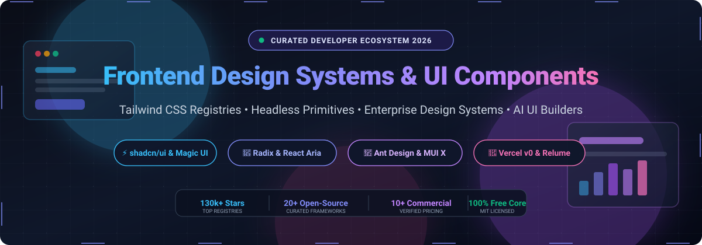

# 🎨 Awesome Frontend Design Systems & UI Components

  

  
  
  
  
  

---

## 🌟 Overview & SEO Summary

A comprehensive, curated collection of the **best frontend design systems**, **open-source UI component libraries**, **copy-paste Tailwind CSS registries**, **accessible headless primitives**, and **AI-powered UI generators**. Whether you are building high-scale React, Vue, Svelte, or Next.js web applications, this directory indexes production-ready UI frameworks, design tokens, responsive layout blocks, and executive analytics kits.

### 🔑 Key Topic Tags & Technologies
`frontend` • `design-systems` • `ui-components` • `tailwind-css` • `shadcn-ui` • `react` • `vue` • `headless-ui` • `radix-ui` • `web-components` • `design-tokens` • `storybook` • `material-ui` • `ant-design` • `v0-ecosystem` • `awesome-list`

---

## 📑 Table of Contents
- [📊 Sector Overview & Market Dynamics](#-sector-overview--market-dynamics)
- [☁️ SaaS/Hosted & Commercial Platforms](#️-saashosted--commercial-platforms)
- [💻 Open-Source GitHub Projects](#-open-source-github-projects)
- [📈 Star History](#-star-history)
- [💖 Support & Community](#-support--community)
- [🤝 How to Contribute](#-how-to-contribute)
- [⚠️ Disclaimer](#️-disclaimer)

---

## 📊 Sector Overview & Market Dynamics

The global Frontend Development Tools, UI Component Libraries & Design System Software market is estimated at **$6.8B to $8.5B in 2026** (expanding at an ~18%–22% CAGR), propelled by rapid enterprise adoption of design tokens, Tailwind CSS styling engines, and AI-assisted generative UI tooling. The market structure is **moderately fragmented**: while underlying open-source foundational primitives and registries (`shadcn/ui`, `Tailwind CSS`, `Radix UI`, `MUI`, `Ant Design`) exhibit strong winner-take-most dynamics in developer mindshare, commercial monetization remains fragmented across niche enterprise pro-blocks, complex data grids, specialized Figma kits, and AI design copilots.

---

## ☁️ SaaS/Hosted & Commercial Platforms

*Sorted descending by company valuation / scale.*

| Platform | Description | Scale (Valuation / Revenue) | Starting Paid Tier | Free Tier / Trial Limit |
| :--- | :--- | :--- | :--- | :--- |
| **[Ant Design Pro (Ant Group)](https://ant.design)** | 🏢 Enterprise-class out-of-the-box admin dashboard templates, ProComponents, and financial UI design system backed by Ant Group. | **~$78B+ Parent Valuation** (~$28B+ parent annual revenue) | **$0 / Free Open-Source** (Commercial AntV / enterprise design consulting & templates optional) | **100% Free Forever** (Full MIT-licensed Ant Design, ProComponents, and Ant Design Pro scaffolding free for commercial use) |
| **[Shadcn UI Cloud / Vercel v0 Ecosystem](https://shadcn.com)** | 🤖 AI-powered UI generator (`v0`) and hosted CLI component registry ecosystem built around `shadcn/ui`, Tailwind CSS, and Radix/Base UI. | **$3.25B Parent Valuation** (~$150M+ ARR, Vercel) | **$20 / month** (v0 Premium plan for enhanced AI generation credits and priority fast generation) | **Forever Free Tier** (100% free `shadcn` CLI, open component blocks, and free monthly v0 AI generation credits of $10 equivalent) |
| **[Tremor Pro (Vercel)](https://tremor.so)** | 📊 Commercial dashboard blocks, KPI cards, and executive analytics UI templates built on top of the open-source Tremor React + Tailwind library. | **$3.25B Parent Valuation** (~$150M+ ARR, Vercel) | **$249 one-time payment** (Individual lifetime commercial license for all dashboard layouts and charts) | **Forever Free Open-Source Core & Free Blocks** (Core `@tremor/react` components and 30+ copy-paste chart/KPI blocks free forever) |
| **[Tailwind Plus (formerly Tailwind UI)](https://tailwindcss.com)** | 🎨 Official commercial library of 500+ professionally designed, responsive React, Vue, and HTML UI components, templates, and Catalyst kit by Tailwind Labs. | **~$50M–$100M Est. Valuation** (~$15M+ est. ARR; bootstrapped profitable creator of Tailwind CSS) | **$299 one-time payment** (Personal lifetime license for full component suite; $799 for Team license) | **Forever Free Preview Components** (Free sample headers, hero sections, forms, and dialogs in every category + MIT Tailwind CSS core) |
| **[Material UI Store / MUI X (MUI)](https://mui.com)** | 🧱 Commercial enterprise extensions (MUI X Data Grid Pro/Premium, Date Range Pickers, Charts) and curated React UI templates from MUI. | **~$50M–$100M Est. Valuation** (~$15M+ est. ARR; bootstrapped profitable React UI company) | **$15 / developer / month** billed annually ($180/yr for MUI X Pro; $49/dev/mo Premium) | **Forever Free MIT Community Core** (100% free `@mui/material`, Joy UI, Base UI, and MUI X Community Data Grid/Charts) |
| **[Relume](https://relume.io)** | ⚡ AI-powered sitemap, wireframe, and Webflow/React/Figma UI component library featuring 1,000+ unstyled/Tailwind layout components. | **~$30M–$50M Est. Valuation** (~$8M–$12M+ est. ARR; bootstrapped Australian SaaS) | **$18 / month** billed annually ($24/mo monthly for Starter plan) | **Forever Free Starter Tier** (**1 project**, 1 AI sitemap/wireframe page, and free access to core Webflow/React/Figma component samples) |
| **[Chakra UI Pro](https://chakra-ui.com)** | ⚡ Commercial collection of 210+ responsive, accessible marketing and application UI components built by the creators of Chakra UI and Ark UI. | **~$10M–$25M Est. Scale** (Profitable indie design-system studio) | **$299 one-time payment** (Personal lifetime license; $899 for Team license with Figma design kit) | **Forever Free Open-Source Core & Free Snippets** (MIT Chakra UI v3 + Ark UI primitives and sample Pro recipes free forever) |
| **[Flowbite Pro](https://flowbite.com)** | 🌊 Commercial library of 400+ interactive Tailwind CSS UI blocks, admin dashboards, Figma design system, and AI UI generator. | **~$5M–$15M Est. Scale** (Bootstrapped European open-core UI company) | **$199 one-time payment** (Developer lifetime license; $399 for Team license) | **Forever Free Open-Source Core** (60+ open-source MIT Flowbite components, icons, and starter templates free forever) |
| **[HeroUI Pro (formerly NextUI Pro)](https://heroui.com)** | 🚀 Commercial collection of 230+ modern, animated Tailwind CSS + React Aria UI blocks and application templates by the creators of HeroUI. | **~$5M–$15M Est. Scale** (Independent creator-led open-core UI company) | **$249 one-time payment** (Solo lifetime license; $499 for Team license with Figma files) | **Forever Free Open-Source HeroUI Core** (All 40+ MIT-licensed HeroUI v2 components and starter templates free forever) |
| **[Mantine UI (Open-Source + Sponsor Ecosystem)](https://mantine.dev)** | 🛡️ Full-featured React components and hooks library paired with 120+ free responsive Mantine UI application and marketing blocks. | **Community & Sponsor-Backed** (Maintained by Vitaly Rtishchev & open-source sponsors) | **$0 / Free Open-Source** (Optional GitHub Sponsors tiers starting at $15/month for priority support) | **100% Free Forever** (All 100+ React components, 50+ hooks, and 120+ Mantine UI responsive blocks released under MIT) |

---

## 💻 Open-Source GitHub Projects

*Ranked descending by GitHub star count.*

| Project | Description |
| :--- | :--- |
| **[shadcn-ui/ui](https://github.com/shadcn-ui/ui)**  | ✨ Composable, accessible components with thoughtful defaults. Build your own component library with code you can customize, extend, and make your own. |
| **[ant-design/ant-design](https://github.com/ant-design/ant-design)**  | 🏢 An enterprise-class UI design language and React UI library. |
| **[mui/material-ui](https://github.com/mui/material-ui)**  | 🧱 Material UI: Comprehensive React component library that implements Google's Material Design. Free forever. |
| **[tailwindlabs/tailwindcss](https://github.com/tailwindlabs/tailwindcss)**  | 🎨 A utility-first CSS framework for rapid UI development. |
| **[storybookjs/storybook](https://github.com/storybookjs/storybook)**  | 📚 Storybook is the industry standard workshop for building, documenting, and testing UI components in isolation. |
| **[saadeghi/daisyui](https://github.com/saadeghi/daisyui)**  | 🌼 The most popular, free and open-source Tailwind CSS component library with semantic class names. |
| **[chakra-ui/chakra-ui](https://github.com/chakra-ui/chakra-ui)**  | ⚡ Chakra UI is a component system for building SaaS products with speed. |
| **[mantinedev/mantine](https://github.com/mantinedev/mantine)**  | 🛡️ A fully featured React components library with dark theme support and custom hooks. |
| **[heroui-inc/heroui](https://github.com/heroui-inc/heroui)**  | 🚀 Beautiful, fast and modern React UI library based on React Aria and Tailwind CSS (Previously NextUI). |
| **[tailwindlabs/headlessui](https://github.com/tailwindlabs/headlessui)**  | 🧩 Completely unstyled, fully accessible UI components, designed to integrate beautifully with Tailwind CSS. |
| **[magicuidesign/magicui](https://github.com/magicuidesign/magicui)**  | 🪄 UI Library for Design Engineers. Animated components and effects you can copy and paste into your apps. |
| **[radix-ui/primitives](https://github.com/radix-ui/primitives)**  | 💎 Radix Primitives is an open-source UI component library for building high-quality, accessible design systems and web apps. |
| **[adobe/react-spectrum](https://github.com/adobe/react-spectrum)**  | 🔴 A collection of libraries and tools (including React Aria) that help you build adaptive, accessible, and robust user experiences. |
| **[shoelace-style/shoelace](https://github.com/shoelace-style/shoelace)**  | 👟 Web Awesome (formerly Shoelace): A library of customizable, framework-agnostic web components. |
| **[themesberg/flowbite](https://github.com/themesberg/flowbite)**  | 🌊 Open-source UI component library and front-end development framework based on Tailwind CSS. |
| **[ariakit/ariakit](https://github.com/ariakit/ariakit)**  | 🎯 Toolkit with accessible components, styles, and examples for your next web app. |
| **[primefaces/primereact](https://github.com/primefaces/primereact)**  | 👑 The Most Complete React UI Component Library featuring 80+ components and themes. |
| **[vercel-labs/ui](https://github.com/vercel-labs/ui)**  | 🧪 A library of behaviors for agents to build and drive the next generation of user interfaces. |
| **[chakra-ui/ark](https://github.com/chakra-ui/ark)**  | 🌐 Unstyled, accessible UI components for your design system. Works in React, Vue, Solid, and Svelte. |
| **[tremorlabs/tremor](https://github.com/tremorlabs/tremor)**  | 📊 Copy & Paste React components and charts to build modern dashboard web applications. |

---

## 📈 Star History

---

## 💖 Support & Community

Thank you so much for exploring and using this curated directory! If you found this list helpful for choosing your next design system, UI component library, or frontend architecture:

- ⭐ **Star this repository** to show your support and help other developers discover it.
- 🍴 **Fork the project** to maintain your personal reference or suggest new additions.
- 📢 **Share with your team, network, or community** on X/Twitter, LinkedIn, Discord, or Reddit.
- ☕ **Buy a coffee / Sponsor**: If you'd like to support ongoing curation, updates, and maintenance of developer resources, please consider sponsoring via the [GitHub Sponsor Dashboard](https://github.com/sponsors/ishandutta2007).

---

## 🤝 How to Contribute

Contributions are warmly welcomed! To add or update a frontend design system, UI library, or commercial registry:

1. Fork this repository.
2. Create a new branch: `git checkout -b add/my-awesome-library`.
3. Add your entry following the established table formats (ensure factual pricing and accurate links).
4. Commit your changes: `git commit -m "feat: add [Library Name]"`.
5. Push to the branch: `git push origin add/my-awesome-library`.
6. Open a Pull Request for review!

---

## ⚠️ Disclaimer

All product names, logos, and brands are property of their respective owners. Mention of SaaS or commercial offerings is for informational and educational comparison purposes only and does not imply endorsement.
